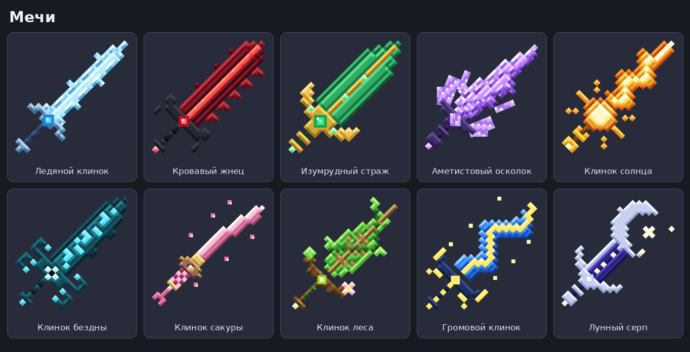
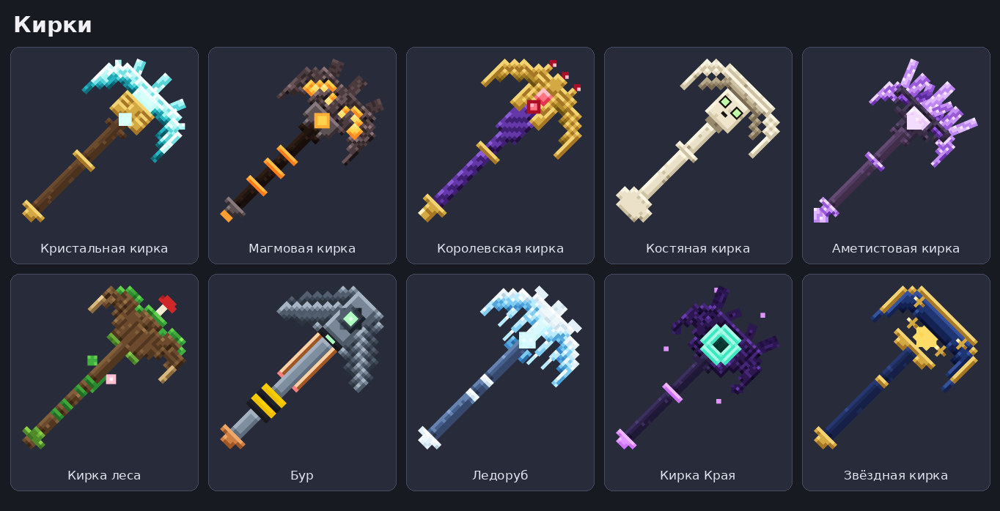
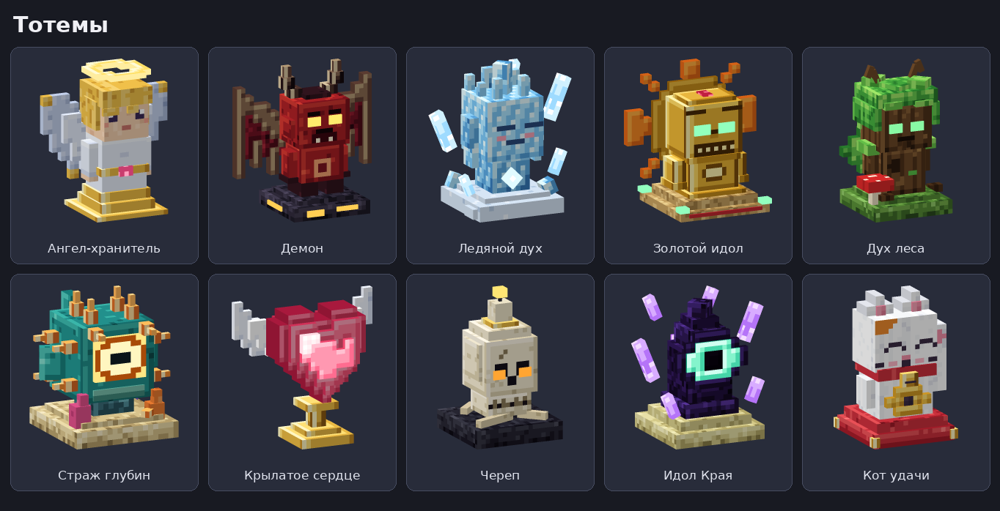
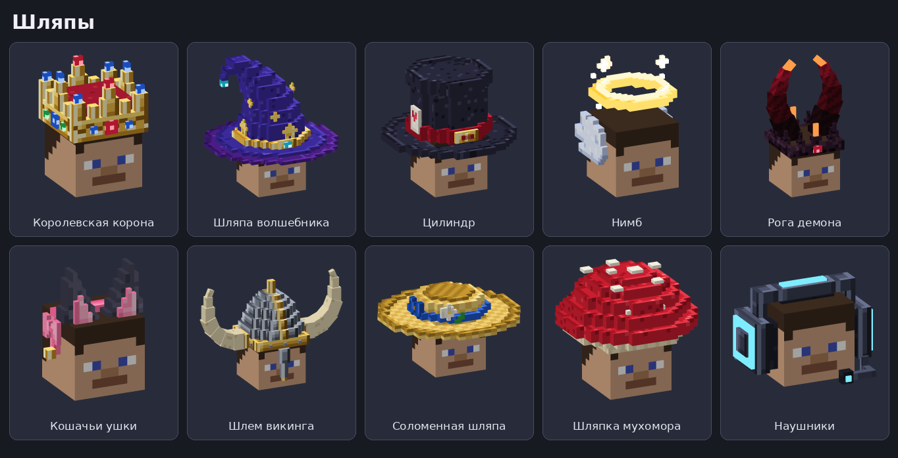

# AppleCosmetic

Плагин косметики для **Paper 1.21.11** (Java 21). Меню открывается командой `/cosmetics`,
весь интерфейс и все настройки — на русском языке.

## Возможности

- **Облики мечей, кирок и тотемов.** Выбранный облик меняет внешний вид всех таких предметов
  в инвентаре игрока. Урон, чары и прочность не меняются — меняется только модель. Облик тотема
  заменяет и анимацию срабатывания.
- **Шляпы.** Шляпу видят все игроки поблизости вместо шлема, при этом настоящий шлем остаётся
  надетым и защищает.
- **Эффекты убийства, критического удара, снарядов и смерти** из частиц, звуков, молний
  и фейерверков. Правая кнопка мыши в меню показывает эффект только самому игроку.
- **40 встроенных 3D-моделей** — по 10 мечей, кирок, тотемов и шляп — для ItemsAdder,
  а шляпы ещё и для BetterModel.
- **Свои модели** из ItemsAdder, Nexo, Oraxen, CraftEngine, из любого ресурспака
  (`item_model` или `CustomModelData`), а для шляп — модели BetterModel.

Из коробки настроено по 10 обликов мечей, кирок, тотемов и шляп и 57 эффектов
(15 убийства, по 14 крита, снарядов и смерти). Эффекты собраны из частиц Minecraft
и работают без ресурспака.

## 3D-модели






Изображения получены программным рендером из тех же файлов моделей и текстур, что лежат в наборе.

Модели встроены в файл плагина и устанавливаются сами (`models.auto-install` в `config.yml`):

| Плагин | Куда копируется | Что сделать после первой установки |
| --- | --- | --- |
| ItemsAdder 4.0.13+ | `plugins/ItemsAdder/contents/applecosmetic` — предметы `applecosmetic:sword_frost`, `applecosmetic:hat_crown` и другие | выполнить `/iazip` |
| BetterModel | `plugins/BetterModel/models` — шляпы `ac_hat_crown`, `ac_hat_wizard` и другие | выполнить `/bettermodel reload` |

BetterModel закрепляет модели на игроке, поэтому для него есть только шляпы: мечи, кирки и тотемы —
это предметы, и их модели приходят из ItemsAdder. В `item` у каждой встроенной косметики указан
список: сначала модель из набора, затем запасной вариант. Пока ItemsAdder и BetterModel не
установлены, используется обычный предмет Minecraft:

```yaml
item: ["itemsadder:applecosmetic:hat_crown", "bettermodel:ac_hat_crown", GOLD_BLOCK]
```

Модели описаны кодом в `tools/models/defs` и собираются командой `python3 tools/models/build.py`
(нужны Python 3 с Pillow и NumPy); она же обновляет набор и листы превью.

## Сборка

Нужен JDK 21.

```
./mvnw package
```

Готовый файл: `target/AppleCosmetic-1.0.0.jar`. Положите его в папку `plugins` сервера.

## Команды и права

| Команда | Описание | Право |
| --- | --- | --- |
| `/cosmetics` (`/cosmetic`, `/cosm`, `/косметика`) | открыть меню | `applecosmetic.use` (есть у всех) |
| `/cosmetics reload` | перечитать все файлы | `applecosmetic.admin` (операторы) |

Права на косметику:

| Право | Что даёт |
| --- | --- |
| `applecosmetic.all` | вся косметика (по умолчанию у операторов) |
| `applecosmetic.<категория>.*` | вся косметика категории |
| `applecosmetic.<категория>.<id>` | одна позиция |

Категории: `sword`, `pickaxe`, `totem`, `hat`, `kill`, `crit`, `projectile`, `death`.
Например, `applecosmetic.sword.trident`. Если игрок теряет право, косметика снимается сама.
Чтобы открыть всю косметику всем, поставьте `settings.require-permissions: false` в `config.yml`.

## Файлы настроек

| Файл | Что в нём |
| --- | --- |
| `config.yml` | общие настройки и вид меню |
| `messages.yml` | сообщения |
| `cosmetics/swords.yml`, `pickaxes.yml`, `totems.yml`, `hats.yml` | облики и шляпы |
| `effects/kill.yml`, `crit.yml`, `projectile.yml`, `death.yml` | эффекты |
| `players/` | выбор игроков, по файлу на игрока |

В начале каждого файла описаны все его поля. Текст можно писать в формате MiniMessage
(`<gradient:#ff0000:#ffaa00>…</gradient>`) или привычными кодами (`&c`, `&#ff8800`).

## Свои предметы и модели

В полях `icon` (иконка в меню) и `item` (откуда брать модель) можно указать:

| Запись | Источник |
| --- | --- |
| `DIAMOND_SWORD` | обычный предмет Minecraft |
| `PAPER:1001` | предмет с CustomModelData |
| `model:пространство:путь` | модель из ресурспака напрямую (`item_model`) |
| `itemsadder:пространство:предмет` | ItemsAdder |
| `nexo:предмет` | Nexo |
| `oraxen:предмет` | Oraxen |
| `craftengine:пространство:предмет` | CraftEngine |
| `head:текстура` | голова с текстурой |
| `bettermodel:модель` | модель BetterModel на игроке (только `item` у шляп) |

Вместо одной записи можно указать список — используется первый доступный вариант.

Пример облика меча из ItemsAdder:

```yaml
items:
  ice_sword:
    name: "<gradient:#7de8ff:#4d9dff>Ледяной клинок</gradient>"
    item: "itemsadder:mypack:ice_sword"
    lore:
      - "<gray>Холодная сталь севера."
```

Пример эффекта убийства со своей иконкой:

```yaml
effects:
  inferno:
    name: "<gold>Огненный вихрь"
    icon: "itemsadder:mypack:icon_inferno"
    sounds:
      - { name: entity.blaze.shoot, volume: 1.0, pitch: 0.8 }
    layers:
      - { animation: HELIX, particle: FLAME, radius: 0.9, height: 2.4, duration: 24 }
```

## Как это устроено

- Облик записывается в сам предмет, пока тот лежит в инвентаре владельца. Когда предмет
  выбрасывают, кладут в сундук или игрок выходит с сервера, предмету возвращается обычный вид,
  поэтому облик нельзя передать другому игроку.
- Предметы, у которых уже есть своя модель, облик не получают.
- Шляпа — это предмет, который клиенты видят в слоте шлема. При `hats.show-to-self: true`
  игрок видит шляпу и у себя, в том числе в слоте шлема в инвентаре.
